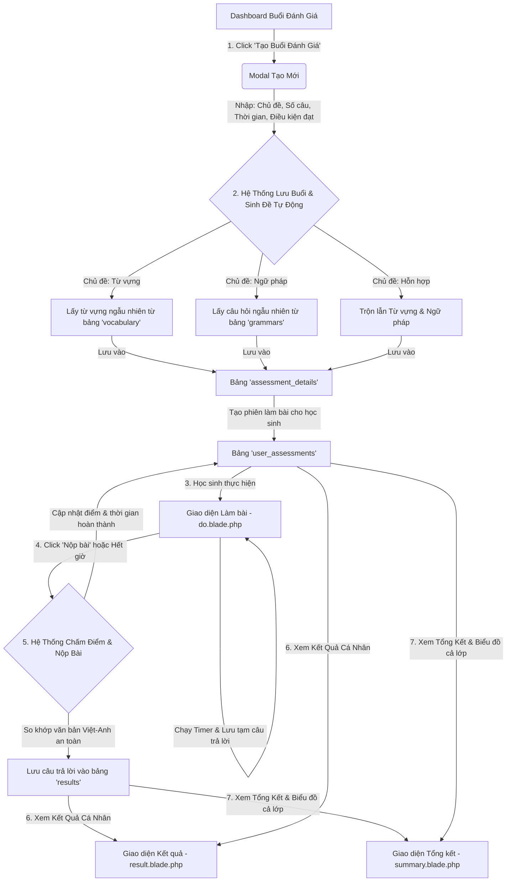

# HƯỚNG DẪN KỸ THUẬT & LUỒNG HOẠT ĐỘNG: BUỔI ĐÁNH GIÁ (ASSESSMENT)

Tài liệu này mô tả chi tiết luồng nghiệp vụ và cấu trúc kỹ thuật của hệ thống **Buổi đánh giá** (bao gồm **Đánh giá Từ vựng** và **Đánh giá Ngữ pháp**) trong ứng dụng Quản lý Tiếng Anh.

---

## 1. SƠ ĐỒ LUỒNG HOẠT ĐỘNG (WORKFLOW DIAGRAM)

---

## 2. CẤU TRÚC CƠ SỞ DỮ LIỆU & QUAN HỆ (DATABASE & RELATIONSHIPS)

Luồng đánh giá được quản lý bởi **4 bảng chính** và liên kết chặt chẽ với ngân hàng dữ liệu câu hỏi:

### A. Các bảng lưu trữ cấu trúc đề thi
1.  **`assessments`** (Thông tin buổi đánh giá):
    *   `id`: Khóa chính.
    *   `title`: Tiêu đề buổi đánh giá.
    *   `type`: Loại đánh giá (`vocabulary`, `grammar`, `mixed`).
    *   `duration`: Thời gian làm bài (phút).
    *   `quantity`: Số lượng câu hỏi.
    *   `min_score`: Điểm số tối thiểu để đạt (Hệ 10 hoặc số câu).
    *   `min_performance`: Hiệu suất hoàn thành tối thiểu (%).
    *   `start_time`, `end_time`: Thời gian bắt đầu và kết thúc buổi thi.
2.  **`assessment_details`** (Chi tiết câu hỏi trong đề):
    *   `id`: Khóa chính.
    *   `assessment_id`: Khóa ngoại liên kết tới bảng `assessments`.
    *   `vocabulary_id`: Khóa ngoại liên kết tới bảng `vocabulary` (nullable).
    *   `grammar_id`: Khóa ngoại liên kết tới bảng `grammars` (nullable).
    *   `question`: Câu hỏi hiển thị.
    *   `answer`: Đáp án đúng để đối khớp hệ thống.
    *   `skill`: Kỹ năng (`vocabulary`, `grammar`).
    *   `point`: Điểm của câu hỏi (mặc định = 1).

### B. Các bảng lưu trữ quá trình làm bài của học sinh
3.  **`user_assessments`** (Lượt tham gia đánh giá của từng học sinh):
    *   `id`: Khóa chính.
    *   `user_id`: Khóa ngoại liên kết tới bảng `users`.
    *   `assessment_id`: Khóa ngoại liên kết tới bảng `assessments`.
    *   `started_at`: Thời gian bắt đầu mở đề làm bài.
    *   `finished_at`: Thời gian nhấn nút nộp bài (hoặc thời gian tự động khóa đề khi hết giờ).
    *   `score`: Điểm số đạt được (số câu đúng thực tế).
4.  **`results`** (Chi tiết câu trả lời của từng câu hỏi):
    *   `id`: Khóa chính.
    *   `user_id`: Khóa ngoại liên kết tới bảng `users`.
    *   `assessment_id`: Khóa ngoại liên kết tới bảng `assessments`.
    *   `assessment_detail_id`: Khóa ngoại liên kết tới bảng `assessment_details`.
    *   `user_answer`: Câu trả lời thực tế học sinh nhập vào.
    *   `is_correct`: Đánh dấu kết quả (`1` = Đúng, `0` = Sai).

---

## 3. CHI TIẾT CÁC LUỒNG CHỨC NĂNG CỐT LÕI

### LUỒNG 1: TẠO BUỔI ĐÁNH GIÁ (Assessment Creation)
*   **Mô tả**: Giáo viên/Quản trị viên mở Modal tại trang Dashboard chọn chủ đề đánh giá (`Từ vựng`, `Ngữ pháp`, hoặc `Hỗn hợp`), chọn số lượng câu, thiết lập thời gian làm bài, cấu hình ngưỡng đạt yêu cầu.
*   **Hành động Backend (`AssessmentController@store`)**:
    1.  Validate các tham số truyền vào bao gồm cả khoảng ID từ vựng (`from` -> `to`) và cấu hình hiệu suất tối thiểu.
    2.  Tạo bản ghi trong bảng `assessments`.
    3.  Tự động truy vấn ngẫu nhiên (`inRandomOrder()`) các câu hỏi phù hợp từ ngân hàng đề:
        *   **Nếu chọn Từ vựng**: Lấy từ bảng `vocabulary` (hỗ trợ lấy theo khoảng ID học tập). Sinh câu hỏi tự động dạng `"Nghĩa của từ '...' là gì?"`.
        *   **Nếu chọn Ngữ pháp**: Lấy trực tiếp câu hỏi ngữ pháp từ bảng `grammars` thông qua Model `Grammar`.
    4.  Lưu toàn bộ câu hỏi được chọn vào bảng `assessment_details` dưới dạng đề thi tĩnh để đảm bảo đề thi không bị thay đổi khi ngân hàng câu hỏi gốc cập nhật.

### LUỒNG 2: THỰC HIỆN BÀI ĐÁNH GIÁ (Exam Taking)
*   **Mô tả**: Học sinh click vào buổi đánh giá từ Dashboard để tiến hành làm bài thi trực tuyến.
*   **Hành động Backend (`AssessmentController@doExam`)**:
    1.  Kiểm tra quyền truy cập buổi thi.
    2.  Khởi tạo bản ghi tham gia trong bảng `user_assessments` (ghi nhận thời gian bắt đầu `started_at`).
    3.  Tải danh sách câu hỏi tĩnh từ bảng `assessment_details` và hiển thị ra giao diện thi.
*   **Tính năng trên giao diện (`do.blade.php`)**:
    *   **Interactive Timer**: Đồng hồ đếm ngược kéo thả di động hiển thị thời gian còn lại trực quan. Khi đồng hồ về `0`, hệ thống tự động khóa đề và kích hoạt submit bài thi.
    *   **Thanh điều hướng câu hỏi**: Theo dõi câu nào đã điền/chưa điền để học sinh không bỏ sót câu hỏi.

### LUỒNG 3: NỘP BÀI & CHẤM ĐIỂM (Assessment Submission)
*   **Mô tả**: Học sinh nhấn nút "Nộp bài" hoặc hệ thống tự động gửi yêu cầu khi hết giờ làm bài.
*   **Hành động Backend (`AssessmentController@submit`)**:
    1.  Hệ thống đóng băng phiên làm bài của học sinh (ngăn chặn việc sửa kết quả sau khi đã nộp bài).
    2.  Duyệt qua từng câu hỏi trong đề, tiến hành chấm điểm tự động:
        *   Sử dụng hàm đối khớp chuỗi an toàn không phân biệt hoa thường và khoảng trắng (`mb_strtolower(trim($userAnswer)) === mb_strtolower(trim($detail->answer))`) để chấm điểm chuẩn xác cho học sinh Việt Nam.
    3.  Sử dụng cơ chế an toàn giao dịch (`DB::beginTransaction` / `DB::commit`) để cập nhật câu trả lời vào bảng `results` theo cấu trúc duy nhất của từng học sinh (`user_id`).
    4.  Cập nhật thời điểm hoàn thành `finished_at` và tổng số điểm `score` vào bảng `user_assessments`.

### LUỒNG 4: XEM KẾT QUẢ & TỔNG KẾT (Results & Statistics)
*   **Mô tả**: Sau khi nộp bài, học sinh được chuyển hướng trực tiếp đến trang kết quả cá nhân và trang tổng kết lớp học.
*   **Giao diện Xem kết quả (`result.blade.php`)**:
    *   Hiển thị chi tiết số câu Đúng, Sai, và Chưa trả lời của học sinh kèm thanh tiến trình màu sắc sinh động (Xanh/Đỏ/Xám).
    *   Bảng so sánh chi tiết giữa đáp án đúng của hệ thống và câu trả lời thực tế của người dùng.
    *   Đánh giá chi tiết hiệu suất thực tế (Words per hour) so với dự kiến.
*   **Giao diện Tổng kết (`summary.blade.php`)**:
    *   **Thống kê lớp học**: Điểm trung bình, điểm cao nhất, điểm thấp nhất toàn lớp tham gia buổi đánh giá.
    *   **Bảng xếp hạng hiệu suất**: Theo dõi toàn bộ học sinh trong lớp kèm thời gian làm bài chi tiết của từng học sinh.
    *   **Danh sách từ vựng sai cá nhân**: Tổng hợp tất cả các từ vựng/câu hỏi ngữ pháp mà chính học sinh đó làm sai để hỗ trợ ôn tập nhanh trực tiếp từ thẻ Dashboard.
    *   **Biểu đồ phân tích trực quan**: 
        1.  Biểu đồ tròn (`Pie chart`) phân tích phân bố điểm của cả lớp (Yếu, Trung bình, Khá, Giỏi).
        2.  Biểu đồ cột (`Bar chart`) phân tích chính xác tỷ lệ đúng theo từng kỹ năng kỹ năng (**Từ vựng (Vocabulary)** vs. **Ngữ pháp (Grammar)**) của học sinh giúp nhận biết điểm yếu cần cải thiện.

---

## 4. CÁC ĐIỂM CẢI TIẾN KỸ THUẬT QUAN TRỌNG ĐÃ THỰC HIỆN

1.  **Sửa lỗi ghi đè dữ liệu của nhiều học sinh**: Trước đây hệ thống chấm bài sử dụng lệnh lưu kết quả kết nối thiếu tham số `user_id` làm cho câu trả lời của học sinh B ghi đè lên kết quả của học sinh A. Đã bổ sung `user_id` vào khóa tìm kiếm của `updateOrCreate`.
2.  **Khắc phục lỗi thiếu Model `Grammar`**: Tạo mới Model `Grammar.php` liên kết chính xác tới bảng `grammars` để hỗ trợ hệ thống truy xuất ngân hàng câu hỏi ngữ pháp ngẫu nhiên mà không bị lỗi biên dịch.
3.  **Tách biệt số liệu Cá nhân & Toàn lớp**: Phân tách luồng tính toán dữ liệu của cá nhân học sinh hiện tại và số liệu thống kê trung bình của lớp học trong trang Tổng kết giúp tránh việc hiển thị nhầm lẫn điểm số của lớp vào thẻ kết quả cá nhân.
4.  **Bổ sung Migration `grammar_id`**: Tạo và chạy migration bổ sung trường `grammar_id` khóa ngoại vào bảng `assessment_details` đảm bảo hệ thống lưu trữ nguồn gốc câu hỏi ngữ pháp đồng bộ giống như từ vựng.
