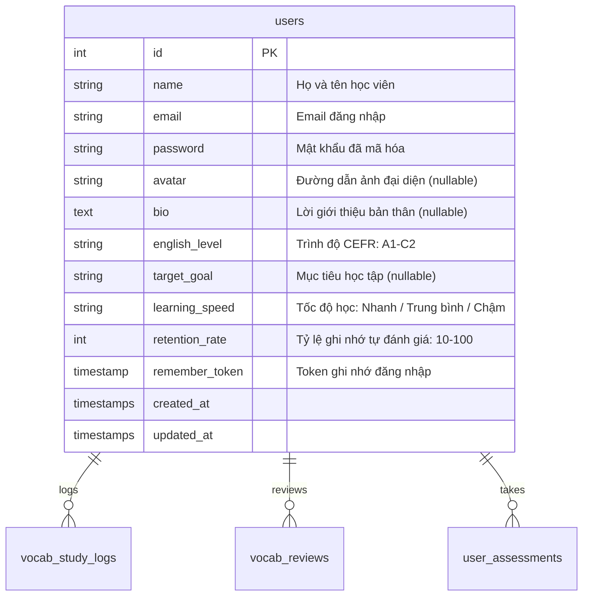
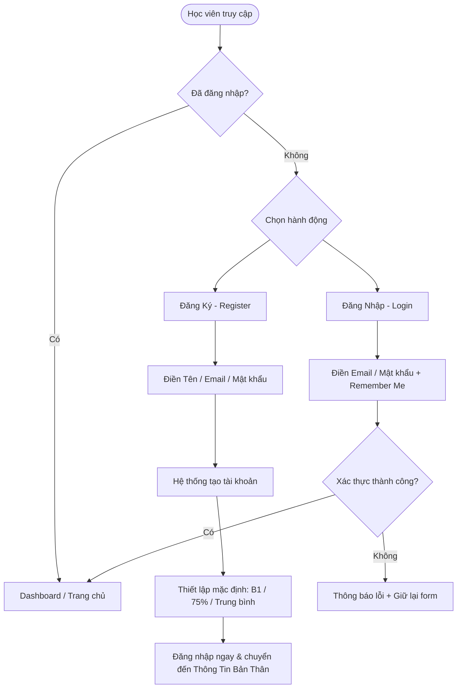
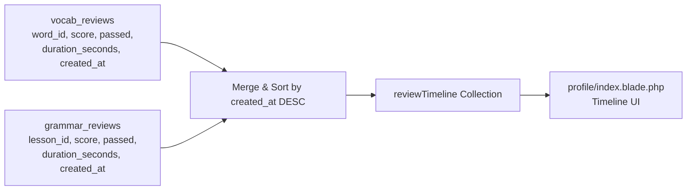

# 👤 Phân Hệ Quản Lý Học Viên (User Module)

Tài liệu này đặc tả toàn bộ thiết kế cơ sở dữ liệu, luồng xử lý, giao diện và các tính năng của phân hệ Học Viên — bao gồm Đăng ký / Đăng nhập, Hồ sơ Cá nhân, Phân tích Chỉ số Học thuật và **Quá Trình Ôn Tập**.

---

## 💾 1. Thiết Kế Cơ Sở Dữ Liệu (Database Schema)

### Bảng `users` (Cập nhật qua Migration)



**Migration tương ứng:** `2026_05_18_100000_add_profile_fields_to_users_table.php`

Các trường mở rộng so với bảng mặc định của Laravel:

| Trường | Kiểu | Mô tả |
| :--- | :--- | :--- |
| `avatar` | `string` (nullable) | Đường dẫn ảnh đại diện tải lên |
| `bio` | `text` (nullable) | Lời giới thiệu ngắn về mục tiêu |
| `english_level` | `string` (default: B1) | Trình độ CEFR tự chọn |
| `target_goal` | `string` (nullable) | Mục tiêu đầu ra (IELTS 7.5...) |
| `learning_speed` | `string` (default: Trung bình) | Tốc độ học tự đánh giá |
| `retention_rate` | `integer` (default: 75) | Khả năng ghi nhớ tự cài đặt (%) |

---

## 🔑 2. Phân Hệ Đăng Nhập & Đăng Ký (Student Authentication)

### 2.1 Luồng Hoạt Động (Auth Flows)



### 2.2 Giao Diện Premium (UI)

- **Glassmorphism** sang trọng trên nền tối, hiệu ứng **Glowing Blobs** gradient
- **Viền phát sáng** khi focus vào các trường nhập liệu
- Thông báo lỗi / thành công có animation `fade-in`
- Đăng Xuất: `Session Invalidation` + tái tạo CSRF token

### 2.3 File Thực Tế

| Loại | File |
| :--- | :--- |
| **Controller** | [AuthController.php](file:///d:/xampp/htdocs/quanlytienganh/app/Http/Controllers/AuthController.php) |
| **View Login** | [auth/login.blade.php](file:///d:/xampp/htdocs/quanlytienganh/resources/views/auth/login.blade.php) |
| **View Register** | [auth/register.blade.php](file:///d:/xampp/htdocs/quanlytienganh/resources/views/auth/register.blade.php) |
| **Sidebar** | [layouts/sidebar.blade.php](file:///d:/xampp/htdocs/quanlytienganh/resources/views/layouts/sidebar.blade.php) |
| **Routes** | [routes/web.php](file:///d:/xampp/htdocs/quanlytienganh/routes/web.php) |

---

## 👤 3. Hồ Sơ Cá Nhân & Phân Tích Chỉ Số Học Thuật (Smart Profile & Analytics)

### 3.1 Các Chỉ Số Được Tính Toán Động

| Chỉ Số | Nguồn Dữ Liệu | Cách Tính |
| :--- | :--- | :--- |
| **Tỷ lệ ghi nhớ thực tế** | `vocab_reviews` | `(Số bài đạt ≥ 80đ / Tổng số bài ôn) × 100%` |
| **Tốc độ phản xạ** | `vocab_reviews.duration_seconds` | Trung bình giây/từ: ≤45s → Nhanh, ≤85s → Trung bình, >85s → Chậm |
| **Streak học tập** | Tần suất `vocab_reviews` | `min(15, số_lượt_ôn × 2)` ngày |
| **Điểm TB từ vựng** | `vocab_reviews.score` | `AVG(score)` |
| **Điểm TB kiểm tra** | `user_assessments.score` | `AVG(score)` |

### 3.2 Cơ Chế Guest-Fallback Thông Minh

```php
// Tự động dùng user đầu tiên khi chưa đăng nhập — chống crash tuyệt đối
$user = auth()->user() ?? User::first();
```

Khi chưa đăng nhập, toàn bộ biểu đồ, lịch sử ôn tập và dashboard vẫn hiển thị dữ liệu mẫu sinh động.

---

## 🧠 4. Bản Đồ Năng Lực & Gợi Ý Lộ Trình Học Tập Cá Nhân Hóa (Radar Skill Map & AI Recommendations) ⭐ MỚI

### 4.1 Mục Tiêu

Nâng cao vai trò của trang Profile từ một dashboard thống kê số liệu thuần túy thành một **"AI Study Coach" (Gia Sư Ảo)** định hướng hành động tức thời:
1. **Radar Skill Map:** Giúp học viên nhận thức được điểm mạnh/điểm yếu của bản thân qua 5 khía cạnh cốt lõi.
2. **AI Study Recommendations:** Tự động đề xuất lộ trình hàng ngày (Daily Action) để ôn tập Spaced Repetition và chinh phục bài mới.

### 4.2 Bản Đồ Năng Lực 5 Chiều (Radar Chart)

Hệ thống tích hợp thư viện **Chart.js** qua CDN để vẽ trực tiếp một biểu đồ Radar tương tác có độ thẩm mỹ cao:
1. **Từ Vựng (Vocabulary Size):** Số từ đã học so với quy mô học liệu (Mục tiêu: 100 từ).
2. **Ngữ Pháp (Grammar Mastery):** Tỉ lệ bài ngữ pháp hoàn thành trọn vẹn (3/3 phần) trên tổng số bài đã học.
3. **Tốc Độ Phản Xạ (Response Speed):** Chuyển đổi từ số giây phản xạ thực tế (Ví dụ: dưới 5s đạt điểm tối đa).
4. **Trí Nhớ (Recall Retention):** Trỏ thẳng đến tỷ lệ ghi nhớ thực tế được tính bằng thuật toán kiểm tra.
5. **Kỷ Luật (Streak & Discipline):** Dựa trên mức độ kiên trì liên tục (Mục tiêu: streak 15 ngày).

### 4.3 Gợi Ý Học Tập Cá Nhân Hóa (Daily Recommendations)

Thuật toán ở controller phân tích dữ liệu học viên theo thời gian thực và đưa ra gợi ý hành động cụ thể thông qua 2 card giao diện chuyên biệt:
* **⚠️ Ôn tập từ vựng gấp (Weakest Words):** Phân tích và lọc ra tối đa 3 từ vựng học viên có điểm ôn tập (`vocab_reviews.score`) thấp nhất (dưới 80 điểm) hoặc các từ đã học nhưng chưa ôn tập lần nào. Nút bấm dẫn trực tiếp đến link ôn tập Active Recall.
* **🎯 Bài học ngữ pháp khuyên học (Grammar Roadmap):** Ưu tiên tìm bài học ngữ pháp dở dang (`in_progress`) học viên chưa hoàn thành đủ 3 phần. Nếu không có, tìm bài mới (`not_started`) kế tiếp trong lộ trình. Nút bấm dẫn thẳng đến trang học chi tiết bài đó.

### 4.4 Data Flow & Logic Xử Lý

```php
// 1. Gợi ý 3 từ vựng yếu nhất
$weakestWords = VocabReview::where('user_id', $user->id)
    ->with('word')->orderBy('score', 'asc')->get()
    ->unique('word_id')->take(3);

// 2. Gợi ý bài học ngữ pháp dở dang hoặc kế tiếp
$suggestedGrammarLesson = null;
foreach ($grammarCategories as $cat) {
    foreach ($cat['topics'] as $topic) {
        foreach ($topic['lessons'] as $les) {
            if ($les['status'] === 'in_progress') {
                $suggestedGrammarLesson = $les;
                break 3;
            }
        }
    }
}
```

---

## 🎓 5. Danh Sách Kiến Thức Đã Học & Hoàn Thành (Knowledge Progress)

### 5.1 Mục Tiêu

Cho phép học viên xem **toàn bộ hành trình học tập của mình** dưới dạng tiến trình trực quan, chia theo từng module (Ngữ Pháp / Từ Vựng), với thanh progress bar, badge trạng thái và bộ lọc thông minh.

### 5.2 Module Ngữ Pháp (Grammar Progress)

**Nguồn dữ liệu:** `grammar_categories` → `grammar_topics` → `grammar_lessons` + `grammar_section_reviews` + `grammar_study_logs`

**Logic xác định trạng thái bài học:**

| Trạng thái | Điều kiện |
| :--- | :--- |
| ✅ **Hoàn thành** | Đủ 3 phần trong `sectionReviews` (Công Thức, Cách Dùng, Ví Dụ) có `status = 'Đạt'` |
| ⚡ **Đang học** | Có từ 1 đến 2 phần đạt chuẩn **hoặc** có study log ghi nhận thời gian học |
| ⬜ **Chưa bắt đầu** | Không có ghi nhận nào |

**Giao diện:**
- **Thanh tổng tiến trình** (gradient xanh dương-cyan): `X / Y bài hoàn thành`
- **Accordion Category**: Mỗi danh mục hiển thị pill tổng quát `X/Y bài — Z%`
- **Lesson row**: Dot màu trạng thái + tên bài (link đến chi tiết) + **3 pips section cụ thể** + mini progress bar + badge
- **3 dấu chấm (Pips) đại diện cụ thể:**
  - Chấm 1: **Công thức (Formula)** — Xanh lá nếu `status = 'Đạt'`, Xám nếu chưa đạt.
  - Chấm 2: **Cách dùng (Usage)** — Xanh lá nếu `status = 'Đạt'`, Xám nếu chưa đạt.
  - Chấm 3: **Ví dụ (Examples)** — Xanh lá nếu `status = 'Đạt'`, Xám nếu chưa đạt.
  - Legend giải thích trực tiếp hiển thị ngay trên Accordion.

### 5.3 Module Từ Vựng (Vocabulary Progress)

**Nguồn dữ liệu:** `vocab_study_logs` (từ đã học) + `vocab_reviews` (để xác định "Thành thạo")

**Logic:**
- **Thành thạo (Mastered):** Từ có ít nhất 1 lần ôn tập với `passed = true`
- **Đang luyện:** Từ đã học nhưng chưa vượt qua lần ôn nào

**Giao diện:**
- **Thanh tổng tiến trình** (gradient tím): `X / Y từ thành thạo`
- **Filter chips**: Tất cả / ✔ Thành thạo / ⚡ Đang luyện — lọc client-side
- **Word grid** (responsive): Mỗi ô hiển thị từ + phiên âm + badge stage (Nền tảng / Phát triển / Nâng cao) + icon ✅ nếu mastered

### 5.4 Data Flow (Controller)

```php
// Grammar: eager load cây Category → Topic → Lesson → SectionReviews + StudyLogs
$grammarCategories = GrammarCategory::with([
    'topics.lessons.sectionReviews',
    'topics.lessons.studyLogs',
])->orderBy('order')->get()->map(function ($category) {
    ...
    // Truy vấn trạng thái từng phần từ grammar_section_reviews trong database
    $formulaPassed = $sections->where('section_name', 'Công Thức (Formula)')->where('status', 'Đạt')->isNotEmpty();
    $usagePassed   = $sections->where('section_name', 'Cách Dùng (Usage)')->where('status', 'Đạt')->isNotEmpty();
    $examplePassed = $sections->where('section_name', 'Ví Dụ (Examples)')->where('status', 'Đạt')->isNotEmpty();
    
    // Đóng gói mảng 'sections_status' truyền trực tiếp cho view để hiển thị 3 dấu chấm chính xác
]);
```

## 🏅 6. Thành Tựu Học Tập (Achievements) ⭐ MỚI

### 6.1 Mục Tiêu

Tạo động lực học tập cho học viên thông qua hệ thống **Huy hiệu Thành tựu (Badges)** trực quan. Hệ thống tự động tính toán tiến trình và mở khóa (unlock) các huy hiệu dựa trên dữ liệu học tập thực tế mà không cần thêm bảng cơ sở dữ liệu mới.

### 6.2 Phân Loại Huy Hiệu (14 Thành Tựu)

Học viên được xếp hạng thành tích qua 4 nhóm huy hiệu và toàn bộ được lưu trữ động trong database (bảng `achievements` và bảng trung gian `user_achievements` có khóa unique ghép đôi `[user_id, achievement_id]`), cho phép kiểm tra điều kiện linh hoạt:

1. **Từ Vựng (Vocab Badges):**
   - 🌱 *Chập Chững Bước Đầu:* Học từ vựng đầu tiên (Target: 1 từ - `vocab_studied`).
   - 📘 *Tích Lũy Từ Vựng:* Học được 10 từ vựng (Target: 10 từ - `vocab_studied`).
   - 📚 *Học Giả Từ Vựng:* Học được 30 từ vựng (Target: 30 từ - `vocab_studied`).
   - ⭐ *Thành Thạo Đầu Tiên:* Đạt 5 từ thành thạo (Target: 5 từ - `vocab_mastered`).
   - 🏆 *Kho Từ Vựng Vàng:* Đạt 20 từ thành thạo (Target: 20 từ - `vocab_mastered`).

2. **Ngữ Pháp (Grammar Badges):**
   - 📖 *Khởi Đầu Ngữ Pháp:* Học bài ngữ pháp đầu tiên (Target: 1 bài - `grammar_lessons_done`).
   - ✅ *Hoàn Thành Đầu Tiên:* Hoàn thành trọn vẹn 1 bài ngữ pháp (3/3 phần) (Target: 1 bài - `grammar_lessons_done`).
   - 🎯 *Học Sinh Chăm Chỉ:* Hoàn thành 5 bài ngữ pháp (Target: 5 bài - `grammar_lessons_done`).

3. **Ôn Tập (Review Badges):**
   - 🎓 *Lần Đầu Ôn Tập:* Hoàn thành bài ôn tập đầu tiên (Target: 1 lượt - `reviews_done`).
   - 🔥 *Lửa Học Tập:* Hoàn thành 10 lượt ôn tập (Target: 10 lượt - `reviews_done`).
   - 🧠 *Trí Nhớ Siêu Phàm:* Đạt tỷ lệ ghi nhớ thực tế >= 80% (Target: 80% - `retention_rate`).

4. **Kỷ Luật (Streak Badges):**
   - ⚡ *Kiên Trì 3 Ngày:* Duy trì streak học 3 ngày liên tục (Target: 3 ngày - `streak_days`).
   - 🌟 *Một Tuần Bất Bại:* Duy trì streak học 7 ngày liên tục (Target: 7 ngày - `streak_days`).
   - 🏅 *Huyền Thoại 15 Ngày:* Duy trì streak học 15 ngày liên tục (Target: 15 ngày - `streak_days`).

### 6.3 Cơ Chế Mở Khóa Thời Gian Thực, Hiệu Ứng Confetti & Chia Sẻ Thành Tựu
- **Trigger mở khóa động:** Khi học viên hoàn thành bất kỳ lượt nộp bài ôn từ vựng hay ngữ pháp nào, `AchievementService` sẽ ngay lập tức đối chiếu dữ liệu hiện tại để tự động lưu vết mở khóa (`unlocked_at`) vào database.
- **Pháo hoa Confetti & Modal Glassmorphic:** Khi phát hiện có huy hiệu mới mở khóa, session flash `newly_unlocked_achievements` sẽ kích hoạt hiệu ứng pháo hoa **Canvas-Confetti** bay rực rỡ khắp màn hình và hiển thị Pop-up Modal chúc mừng Premium Glassmorphism nền tối lung linh, tôn vinh nỗ lực của học viên.
- **Chia sẻ thành tựu:** Modal chúc mừng tích hợp nút **🔗 Chia sẻ thành tựu** giúp học viên nhanh chóng copy thông điệp thành tích độc quyền vào clipboard để khoe ngay với bạn bè.
- **Trạng thái hiển thị:**
  - **Đã đạt (Earned):** Hiển thị rõ nét kèm theo mốc thời gian đạt cúp chính xác dưới dạng: `Đạt ngày: dd/mm/yyyy`.
  - **Chưa đạt (Locked):** Card chuyển xám (grayscale), giảm opacity, hiển thị thanh tiến trình nhỏ dạng `%` và số liệu hiện tại/mục tiêu (`X / Y`) để học viên biết cần cố gắng thêm bao nhiêu.

---

## 📅 7. Quá Trình Ôn Tập (Review Timeline)

### 4.1 Mục Tiêu

Cho phép học viên **nhìn lại toàn bộ hành trình cố gắng** của mình: mỗi lượt ôn tập từ vựng và ngữ pháp, điểm số, thời gian, trạng thái đạt/chưa đạt — tất cả được tổng hợp thành một **timeline dọc trực quan** theo thứ tự từ mới nhất đến cũ nhất.

### 4.2 Cấu Trúc Dữ Liệu (Nguồn)

Timeline được tổng hợp từ **2 nguồn**:



### 4.3 Luồng Xử Lý (Controller Logic)

```php
// 1. Lấy lịch sử ôn tập từ vựng (eager load từ gốc)
$vocabReviewHistory = VocabReview::where('user_id', $user->id)
    ->with('word')->latest()->get()
    ->map(fn($r) => [
        'type'       => 'vocab',
        'label'      => '🔤 Ôn Tập Từ Vựng',
        'subject'    => optional($r->word)->word ?? 'Từ vựng',
        'score'      => $r->score,
        'passed'     => $r->passed,
        'duration'   => $r->duration_seconds,
        'created_at' => $r->created_at,
        'detail_url' => null,
    ]);

// 2. Lấy lịch sử ôn tập ngữ pháp (eager load bài học)
$grammarReviewHistory = GrammarReview::with('lesson')->latest()->get()
    ->map(fn($r) => [
        'type'       => 'grammar',
        'label'      => '📝 Ôn Tập Ngữ Pháp',
        'subject'    => optional($r->lesson)->title ?? 'Bài học ngữ pháp',
        'score'      => $r->score,
        'passed'     => $r->passed,
        'duration'   => $r->duration_seconds,
        'created_at' => $r->created_at,
        'detail_url' => route('grammar.reviews.show', $r->id),
    ]);

// 3. Gộp & sắp xếp theo thời gian (mới nhất → cũ nhất)
$reviewTimeline = $vocabReviewHistory
    ->merge($grammarReviewHistory)
    ->sortByDesc('created_at')
    ->values();

// 4. Thống kê tháng (sparkline 6 tháng gần nhất)
$monthlyStats = $reviewTimeline->groupBy(fn($i) =>
    Carbon::parse($i['created_at'])->format('Y-m')
)->map(fn($g) => $g->count())->take(6);
```

### 4.4 Giao Diện Timeline (UI Features)

| Tính Năng | Mô Tả |
| :--- | :--- |
| **Vertical Timeline** | Đường thẳng gradient xanh-tím chạy dọc, mỗi mốc là một vòng tròn màu Đạt (xanh lá) / Chưa đạt (vàng cam) |
| **Card Nội Dung** | Hiển thị: Loại (badge màu), Tên từ/bài học, Điểm số (màu theo ngưỡng), Badge trạng thái, Thời lượng, Thời gian tương đối |
| **Mini-Cards Tháng** | Thống kê số lượt ôn theo từng tháng (tối đa 4 tháng gần nhất) |
| **Bộ Lọc 3 Tab** | Tất cả / 📘 Từ Vựng / 📖 Ngữ Pháp — lọc ngay phía client (JS) |
| **"Xem thêm"** | Mặc định hiển thị 10 lượt gần nhất, nút bấm để mở toàn bộ lịch sử |
| **Hover Effect** | Card nội dung nổi nhẹ khi di chuột qua |
| **Link Chi Tiết** | Bài ôn ngữ pháp có nút "Xem chi tiết →" dẫn thẳng đến trang so sánh đáp án |
| **Empty State** | Giao diện rỗng đẹp với hướng dẫn khi chưa có buổi ôn nào |

### 4.5 Màu Sắc Theo Điểm Số

| Ngưỡng | Màu |
| :--- | :--- |
| ≥ 80đ (Xuất sắc) | 🟢 `#10b981` (Xanh lá) |
| 60 – 79đ (Khá) | 🟡 `#f59e0b` (Vàng cam) |
| < 60đ (Cần cố gắng) | 🔴 `#ef4444` (Đỏ) |

---

## ⚙️ 8. Định Tuyến Phân Hệ User (Web Routes)

| URL | HTTP | Tên Route | Chức Năng |
| :--- | :--- | :--- | :--- |
| `/profile` | `GET` | `profile.index` | Trang Hồ sơ + Analytics + Quá trình ôn tập |
| `/profile/update` | `POST` | `profile.update` | Cập nhật thông tin hồ sơ & upload avatar |
| `/login` | `GET` | `auth.login` | Form đăng nhập |
| `/login` | `POST` | `auth.login.post` | Xử lý đăng nhập |
| `/register` | `GET` | `auth.register` | Form đăng ký |
| `/register` | `POST` | `auth.register.post` | Xử lý đăng ký |
| `/logout` | `POST` | `auth.logout` | Đăng xuất & hủy session |
| `/achievements-admin` | `GET` | `achievements.admin.index` | Dashboard Admin quản lý danh sách huy hiệu |
| `/achievements-admin/store` | `POST` | `achievements.admin.store` | Thêm mới huy hiệu động |
| `/achievements-admin/{id}/update` | `POST` | `achievements.admin.update` | Sửa thông tin huy hiệu |
| `/achievements-admin/{id}` | `DELETE` | `achievements.admin.destroy` | Xóa huy hiệu khỏi hệ thống |

---

## 🛠️ 9. Nhật Ký File Thực Tế (Physical Files Log)

| Phân Loại | Đường Dẫn File | Vai Trò |
| :--- | :--- | :--- |
| **Migration 1** | [add_profile_fields_to_users_table.php](file:///d:/xampp/htdocs/quanlytienganh/database/migrations/2026_05_18_100000_add_profile_fields_to_users_table.php) | Bổ sung các trường học tập vào bảng `users` |
| **Migration 2** | [create_dynamic_achievements_tables.php](file:///d:/xampp/htdocs/quanlytienganh/database/migrations/2026_05_18_200000_create_dynamic_achievements_tables.php) | Khởi tạo bảng huy hiệu `achievements` và bảng trung gian `user_achievements` |
| **Model 1** | [User.php](file:///d:/xampp/htdocs/quanlytienganh/app/Models/User.php) | Eloquent Model `users`, khai báo quan hệ `achievements()` nhiều-nhiều |
| **Model 2** | [Achievement.php](file:///d:/xampp/htdocs/quanlytienganh/app/Models/Achievement.php) | Eloquent Model cho danh sách huy hiệu động |
| **Model 3** | [UserAchievement.php](file:///d:/xampp/htdocs/quanlytienganh/app/Models/UserAchievement.php) | Eloquent Model lưu vết mở khóa thành tựu của học viên |
| **Seeder** | [AchievementSeeder.php](file:///d:/xampp/htdocs/quanlytienganh/database/seeders/AchievementSeeder.php) | Nạp sẵn 14 huy hiệu mặc định tiêu chuẩn |
| **Service** | [AchievementService.php](file:///d:/xampp/htdocs/quanlytienganh/app/Services/AchievementService.php) | Engine cốt lõi tự động tính toán và mở khóa thành tựu thời gian thực |
| **Controller Auth** | [AuthController.php](file:///d:/xampp/htdocs/quanlytienganh/app/Http/Controllers/AuthController.php) | Xử lý đăng ký, đăng nhập, đăng xuất |
| **Controller Profile** | [ProfileController.php](file:///d:/xampp/htdocs/quanlytienganh/app/Http/Controllers/ProfileController.php) | Dashboard hồ sơ, chỉ số động, biểu đồ Radar Chart và Roadmap gợi ý |
| **Controller Admin** | [AchievementAdminController.php](file:///d:/xampp/htdocs/quanlytienganh/app/Http/Controllers/Admin/AchievementAdminController.php) | Xử lý CRUD danh sách huy hiệu dành cho Admin |
| **View Profile** | [profile/index.blade.php](file:///d:/xampp/htdocs/quanlytienganh/resources/views/profile/index.blade.php) | Hồ sơ học viên, Radar Chart, Spaced Repetition Roadmap và ngày đạt cúp |
| **View Admin** | [index.blade.php](file:///d:/xampp/htdocs/quanlytienganh/resources/views/achievements/admin/index.blade.php) | Giao diện CRUD quản trị huy hiệu Premium |
| **View Review Detail 1** | [review-detail.blade.php](file:///d:/xampp/htdocs/quanlytienganh/resources/views/vocabularies/review-detail.blade.php) | Chi tiết kết quả ôn từ vựng có tích hợp Confetti pháo hoa chúc mừng |
| **View Review Detail 2** | [review-detail.blade.php](file:///d:/xampp/htdocs/quanlytienganh/resources/views/grammars/review-detail.blade.php) | Chi tiết kết quả ôn ngữ pháp có tích hợp Confetti pháo hoa chúc mừng |

---

## 📋 10. Lộ Trình Phát Triển (User Module Checklist)

- [x] **Bước 1:** Migration bổ sung các trường học tập vào bảng `users`
- [x] **Bước 2:** Cập nhật Eloquent Model `User.php` với `$fillable` mới
- [x] **Bước 3:** Xây dựng `AuthController` — Đăng ký, Đăng nhập, Đăng xuất, tự động thiết lập profile mặc định
- [x] **Bước 4:** Thiết kế giao diện Login & Register phong cách Glassmorphism cao cấp
- [x] **Bước 5:** Tích hợp Sidebar thông minh — phân biệt trạng thái chưa/đã đăng nhập
- [x] **Bước 6:** Xây dựng `ProfileController` với chỉ số học thuật động (Retention Rate, Learning Speed, Streak)
- [x] **Bước 7:** Thiết kế trang hồ sơ `profile/index.blade.php` — Cover Card, Stats Overview, Analytics Cards, Edit Form
- [x] **Bước 8:** Cơ chế Guest-Fallback thông minh — chống crash khi chưa đăng nhập
- [x] **Bước 9:** Bổ sung **Section "Quá Trình Ôn Tập"** — Timeline dọc tổng hợp toàn bộ lịch sử ôn tập (Từ Vựng + Ngữ Pháp), bộ lọc tab, thống kê tháng, phân trang "Xem thêm"
- [x] **Bước 10:** Bổ sung **Section "Kiến Thức Đã Học & Hoàn Thành"** — Grammar accordion (Category → Topic → Lesson với progress bar + 3 pips section + badge trạng thái), Vocabulary word grid (Thành thạo / Đang luyện) + filter chips client-side
- [x] **Bước 11:** Bổ sung **Section "Thành Tựu Học Tập" (Achievements)** — 14 huy hiệu động, cơ chế tự động unlock thời gian thực, đồng bộ hóa triệt để pips tiến trình lý thuyết (Formula, Usage, Examples) sửa lỗi logic đếm chuẩn từ database (status='Đạt').
- [x] **Bước 12:** Bổ sung **Section "Bản Đồ Năng Lực & Gợi Ý Lộ Trình Học Tập Cá Nhân Hóa"** — Tích hợp Chart.js vẽ Radar Chart 5 chiều (Từ Vựng, Ngữ Pháp, Phản Xạ, Trí Nhớ, Kỷ Luật), thuật toán Spaced Repetition đề xuất 3 từ vựng yếu nhất cần ôn gấp và 1 bài học ngữ pháp dở dang/kế tiếp cần học trong ngày.
- [x] **Bước 13 [MỚI]:** Tích hợp **Hệ thống Thành tựu động Real-time & Giao diện Quản trị Admin CRUD** — Chạy migration/seeder cho dynamic achievements, trigger Service mở khóa tức thì sau khi nộp bài ôn tập kèm hiệu ứng Confetti rực rỡ và Popup Modal chúc mừng Premium Glassmorphism, nút chia sẻ sao chép nhanh, đồng thời hoàn thành trang quản trị CRUD Admin đầy đủ tính năng thêm/sửa/xóa huy hiệu.

