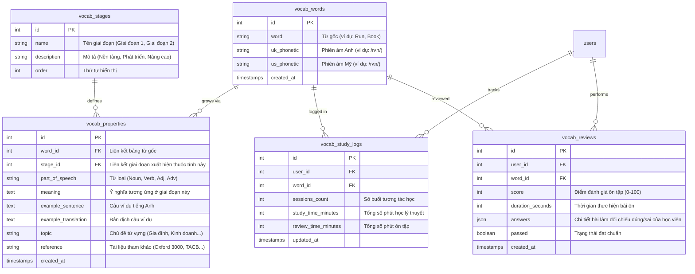

# 🌳 HỆ THỐNG QUẢN LÝ TỪ VỰNG: CÂY PHÁT TRIỂN TỪ VỰNG (VOCABULARY GROWTH TREE)

Ý tưởng cốt lõi của phân hệ này là **Từ vựng là một sinh thể sống, phát triển và phân nhánh qua thời gian (Stages)** chứ không đơn thuần là các thẻ tĩnh. Một từ (ví dụ: _Run_, _Book_, _Family_) sẽ đồng hành cùng học sinh qua nhiều trình độ: từ nghĩa sơ cấp (Khẳng định cơ bản), đến chuyển đổi loại từ (Noun/Verb), rồi đến nghĩa trừu tượng học thuật cùng các ngữ cảnh dịch thuật thực tế.

Tài liệu này đặc tả toàn bộ cơ sở dữ liệu, kiến trúc phần mềm, thuật toán hiển thị cây phân nhánh và quy trình ôn tập Spaced Repetition (Lặp lại ngắt quãng) cho phân hệ Từ Vựng.

---

## 💾 1. Thiết Kế Cơ Sở Dữ Liệu (Database Schema)

Để hỗ trợ một từ có thể "phát triển" thêm nghĩa mới, từ loại mới, ví dụ và chủ đề mới qua từng giai đoạn mà không làm trùng lặp từ gốc, chúng ta thiết kế cơ sở dữ liệu chuẩn hóa (Normalized Schema) gồm các bảng sau:



### Phân tích nghiệp vụ dữ liệu:

- **Từ gốc (`vocab_words`):** Lưu trữ từ vựng và phiên âm chuẩn (UK/US).
- **Giai đoạn (`vocab_stages`):** Định nghĩa các cột mốc phát triển (Ví dụ: `1 -> Nền tảng`, `2 -> Phát triển`, `3 -> Nâng cao`).
- **Thuộc tính phát triển (`vocab_properties`):** Lưu trữ các "cành cây" phát triển. Khi một từ xuất hiện nghĩa mới ở Giai đoạn 2 hoặc 3, ta chỉ cần thêm 1 dòng mới vào bảng này gắn với `stage_id` tương ứng mà không cần nhân bản từ gốc.

---

## 🌲 2. Thuật Toán Hiển Thị Cây Phát Triển (Growth Tree Logic)

Để hiển thị chính xác các nút màu xanh lá cây (`new` - kiến thức mới học ở giai đoạn này) và màu xám (`old` - kiến thức đã học từ giai đoạn trước) như mockup [voca.blade.php](file:///d:/xampp/htdocs/quanlytienganh/resources/views/vocabularies/voca.blade.php), chúng ta áp dụng quy tắc lọc dữ liệu lũy tiến:

- **Tại Giai đoạn $K$:**
    - Toàn bộ thuộc tính thuộc giai đoạn $K$ (`stage_id == K`) sẽ được đánh dấu class là `new` (Màu xanh lá - Kiến thức mới tiếp thu).
    - Toàn bộ thuộc tính thuộc các giai đoạn trước đó (`stage_id < K`) sẽ được đánh dấu class là `old` (Màu xám - Kiến thức đã tích lũy từ trước).

```php
// Logic phân tích cây phát triển của một từ (phía Controller)
public function getGrowthTree($wordId) {
    $word = VocabWord::with('properties.stage')->findOrFail($wordId);
    $stages = VocabStage::orderBy('order', 'asc')->get();

    $treeData = [];
    foreach ($stages as $stage) {
        $treeData[$stage->id] = [
            'stage_name' => $stage->name,
            'description' => $stage->description,
            // Lấy tất cả thuộc tính của từ này tích lũy từ Giai đoạn 1 đến Giai đoạn hiện tại
            'accumulated_properties' => $word->properties()
                ->whereHas('stage', function($q) use ($stage) {
                    $q->where('order', '<=', $stage->order);
                })->get()->map(function($prop) use ($stage) {
                    // Nếu thuộc tính thuộc đúng giai đoạn này -> Đánh dấu là NEW, ngược lại là OLD
                    $prop->status = ($prop->stage_id == $stage->id) ? 'new' : 'old';
                    return $prop;
                })
        ];
    }
    return $treeData;
}
```

---

## 🔄 3. Chức Năng Ôn Tập Củng Cố Từ Vựng (Active Recall Quiz)

Để giúp học sinh thực sự ghi nhớ và vận dụng được các tầng ý nghĩa của từ vựng, hệ thống sẽ tự động xây dựng bài ôn tập dựa trên cấu trúc cây phát triển của từ đó:

### Thử thách 1: Tái hiện từ vựng từ Nghĩa & Phiên âm (Spelling Recall)

- **Mô tả:** Hệ thống đưa ra nghĩa Tiếng Việt (ở Giai đoạn 1) và âm thanh phát âm/phiên âm, yêu cầu học sinh gõ lại chính xác từ Tiếng Anh (Ví dụ: _"Chạy"_ & `/rʌn/` -> Học sinh gõ `run`).
- **Trọng số:** 30% tổng số điểm.

### Thử thách 2: Trắc nghiệm / Tự luận Từ loại & Nghĩa đa tầng (Multi-Meaning Recall)

- **Mô tả:** Hệ thống hiển thị từ gốc (Ví dụ: `Run`), yêu cầu học sinh lựa chọn hoặc viết ra tất cả các từ loại (POS) và tầng ý nghĩa đã được học tính đến giai đoạn hiện tại (Ví dụ: Học sinh phải chỉ ra được _Run_ vừa là `Verb` (Chạy, Điều hành) vừa là `Noun` (Cuộc chạy)).
- **Trọng số:** 40% tổng số điểm.

### Thử thách 3: Bản dịch ví triển (Contextual Translation)

- **Mô tả:** Hiển thị câu ví dụ Tiếng Việt, học sinh phải tự luận viết lại câu dịch Tiếng Anh sử dụng từ vựng đó trong ngữ cảnh chuẩn xác (Ví dụ: _"Cô ấy điều hành một công ty."_ -> Gõ `She runs a company`).
- **Trọng số:** 30% tổng số điểm.

---

## 📊 4. Các Chức Năng Bổ Sung Nâng Cao (Premium Features)

Để wow người dùng và biến module này thành một công cụ học tập tối tân, chúng ta sẽ xây dựng các tính năng sau:

1. **🔊 Tích hợp phát âm tự động (Auto-Audio Pronunciation):**
    - Sử dụng API phát âm miễn phí (như Google TTS hoặc Dictionary API) để hiển thị biểu tượng loa phát âm chuẩn giọng Anh-Anh (UK) và Anh-Mỹ (US) ngay cạnh từ vựng.
2. **📈 Biểu đồ tăng trưởng từ vựng (Vocabulary Growth Chart):**
    - Biểu đồ trực quan hiển thị "kích thước kho từ vựng" của học sinh phình to ra theo thời gian qua từng giai đoạn học tập.
3. **🗂️ Quản lý theo Bộ tài liệu / Chủ đề (Tags & Folders):**
    - Cho phép lọc nhanh từ vựng theo giáo trình học (ví dụ: `Oxford 3000`, `TACB 1&2`) hoặc theo chủ đề đời sống/kinh doanh để học sinh tập trung ôn luyện.
4. **📊 Báo cáo tiến trình học tập cá nhân (Student Vocabulary Statistics Dashboard):**
    - Tổng số từ đã học.
    - Số lượng từ đạt chuẩn Đạt (Mastered - đã ôn tập đúng thời gian và điểm số >= 80).
    - Phân bổ phần trăm từ vựng của học viên theo 3 giai đoạn (Nền tảng - Phát triển - Nâng cao).

---

## 🛠️ 5. Lộ Trình Phát Triển Chi Tiết (Vocabulary Roadmap Checklist)

- [x] **Bước 1:** Viết Migration khởi tạo 5 bảng cơ sở dữ liệu (`vocab_words`, `vocab_stages`, `vocab_properties`, `vocab_study_logs`, `vocab_reviews`). (Hoàn thành trong migration `2026_05_18_000000_create_vocabulary_growth_tables.php`)
- [x] **Bước 2:** Xây dựng các Eloquent Model tương ứng và thiết lập liên kết quan hệ (`VocabWord`, `VocabStage`, `VocabProperty`, `VocabStudyLog`, `VocabReview`). (Hoàn thành trong thư mục `app/Models/Vocabulary/`)
- [x] **Bước 3:** Tạo Seeder dữ liệu mẫu gồm các từ có cấu trúc phát triển phức tạp như _Run_, _Book_, _Family_ để kiểm thử. (Hoàn thành trong `VocabularySeeder.php`)
- [x] **Bước 4 (Phần 1 - Động hóa Tree):** Viết `VocabularyController.php` xử lý logic lấy dữ liệu cây phát triển lũy tiến. (Hoàn thành)
- [x] **Bước 5 (Phần 1 - Động hóa View):** Nâng cấp giao diện [voca.blade.php](file:///d:/xampp/htdocs/quanlytienganh/resources/views/vocabularies/voca.blade.php) thành trang tương tác động, vẽ cây phát triển mượt mà. (Hoàn thành)
- [x] **Bước 4 (Phần 2 - Xử lý Ôn tập):** Viết logic chấm điểm bài ôn tập từ vựng dạng Active Recall (Spelling, Multi-Meaning, Contextual Translation). (Hoàn thành)
- [x] **Bước 5 (Phần 2 - Giao diện Ôn tập):** Thiết kế và nhúng giao diện làm bài ôn tập từ vựng cho học viên. (Hoàn thành)
- [x] **Bước 6 (Quản lý Lộ trình - Admin):** Thiết lập các router CRUD admin, tích hợp Bảng điều khiển quản lý Lộ trình (Stages, Words, Properties) hoàn chỉnh cho quản trị viên. (Hoàn thành)

---

## 🛠️ 6. Nhật Ký Các File Thực Tế Đã Triển Khai (Physical Files Log)

| Phân Loại            | Đường Dẫn File                                                                                                                                                     | Vai Trò & Chức Năng                                                         |
| :------------------- | :----------------------------------------------------------------------------------------------------------------------------------------------------------------- | :-------------------------------------------------------------------------- |
| **Migrations**       | [2026_05_18_create_vocabulary_growth_tables.php](file:///d:/xampp/htdocs/quanlytienganh/database/migrations/2026_05_18_000000_create_vocabulary_growth_tables.php) | Tạo cấu trúc 5 bảng dữ liệu chuẩn hóa của Phân hệ Từ vựng                   |
| **Eloquent Models**  | [VocabWord.php](file:///d:/xampp/htdocs/quanlytienganh/app/Models/Vocabulary/VocabWord.php)                                                                        | Model Từ gốc (`vocab_words`)                                                |
| **Eloquent Models**  | [VocabStage.php](file:///d:/xampp/htdocs/quanlytienganh/app/Models/Vocabulary/VocabStage.php)                                                                      | Model các Giai đoạn phát triển (`vocab_stages`)                             |
| **Eloquent Models**  | [VocabProperty.php](file:///d:/xampp/htdocs/quanlytienganh/app/Models/Vocabulary/VocabProperty.php)                                                                | Model Nhánh thuộc tính / Nghĩa đa tầng (`vocab_properties`)                 |
| **Eloquent Models**  | [VocabStudyLog.php](file:///d:/xampp/htdocs/quanlytienganh/app/Models/Vocabulary/VocabStudyLog.php)                                                                | Model theo dõi buổi học / số phút học lý thuyết và ôn tập                   |
| **Eloquent Models**  | [VocabReview.php](file:///d:/xampp/htdocs/quanlytienganh/app/Models/Vocabulary/VocabReview.php)                                                                    | Model lưu chi tiết các lần làm bài thi ôn tập của học sinh                  |
| **Database Seeders** | [VocabularySeeder.php](file:///d:/xampp/htdocs/quanlytienganh/database/seeders/VocabularySeeder.php)                                                               | Khởi tạo dữ liệu mẫu phức tạp cho các từ _Run_, _Book_, _Family_ và logs    |
| **Controllers**      | [VocabularyController.php](file:///d:/xampp/htdocs/quanlytienganh/app/Http/Controllers/VocabularyController.php)                                                   | Xử lý logic tải từ vựng, chọn từ tiêu điểm và xuất cây phát triển động      |
| **Views (Blade)**    | [voca.blade.php](file:///d:/xampp/htdocs/quanlytienganh/resources/views/vocabularies/voca.blade.php)                                                               | Dashboard trực quan hóa Bảng từ vựng, Sơ đồ lộ trình và Cây phát triển động |
| **Views (Blade)**    | [review.blade.php](file:///d:/xampp/htdocs/quanlytienganh/resources/views/vocabularies/review.blade.php)                                                           | Giao diện làm bài ôn tập Active Recall với đồng hồ bấm giờ trực tiếp        |
| **Views (Blade)**    | [review-detail.blade.php](file:///d:/xampp/htdocs/quanlytienganh/resources/views/vocabularies/review-detail.blade.php)                                             | Trang hiển thị kết quả so sánh đối chiếu câu trả lời chi tiết và tính điểm  |
| **Views (Blade)**    | [admin/index.blade.php](file:///d:/xampp/htdocs/quanlytienganh/resources/views/vocabularies/admin/index.blade.php)                                                 | Bảng điều khiển quản lý Lộ trình (Admin Dashboard) CRUD Stages, Words, Properties  |

---

## 👤 7. Phân Hệ Thông Tin Bản Thân & Phân Tích Chỉ Số Học Tập (Smart Profile & Analytics)

Nhằm đáp ứng yêu cầu theo dõi năng lực học thuật của học viên, chúng tôi đã tích hợp phân hệ **Smart Profile & Analytics** cao cấp kết nối trực tiếp với cơ sở dữ liệu học tập:

### 1. Nâng Cấp Cơ Sở Dữ Liệu
- Khởi chạy migration `2026_05_18_100000_add_profile_fields_to_users_table.php` bổ sung:
  - `avatar`: Đường dẫn ảnh đại diện cá nhân của học sinh.
  - `bio`: Lời tự giới thiệu ngắn về mục tiêu học tập.
  - `english_level`: Trình độ CEFR tự chọn (A1 - C2).
  - `target_goal`: Mục tiêu đầu ra (Ví dụ: IELTS 7.5).
  - `learning_speed`: Tự đánh giá tốc độ học (Nhanh, Trung bình, Chậm).
  - `retention_rate`: Tự đánh giá khả năng ghi nhớ thiết lập (10% - 100%).

### 2. Các Chỉ Số Phân Tích Học Thuật Động (Calculated Metrics)
- **Tốc độ phản xạ thực tế (Response Speed):** Tự động tính thời gian làm bài thi trung bình của học viên qua các lần Active Recall để đưa ra đánh giá thực tế (Ví dụ: `< 45 giây/từ` là Phản xạ Nhanh).
- **Khả năng ghi nhớ thực tế (Memory Retention Rate):** Tính tỷ lệ phần trăm các bài thi đạt điểm chuẩn Mastery (`>= 80đ`) trên tổng số lần ôn tập thực tế.
- **Biểu đồ so sánh:** Trực quan hóa tương phản giữa **Chỉ số Tự đánh giá** và **Chỉ số Động từ Hệ thống**.

### 3. File Thực Tế Đã Triển Khai:
- **Model:** Cập nhật `$fillable` trong [User.php](file:///d:/xampp/htdocs/quanlytienganh/app/Models/User.php).
- **Controller:** [ProfileController.php](file:///d:/xampp/htdocs/quanlytienganh/app/Http/Controllers/ProfileController.php).
- **View:** [profile/index.blade.php](file:///d:/xampp/htdocs/quanlytienganh/resources/views/profile/index.blade.php).
- **Cơ chế Guest-Fallback thông minh:** Hệ thống đã được nâng cấp để nhận diện trạng thái chưa đăng nhập. Khi chưa đăng nhập (`Auth::user()` trả về `null`), hệ thống tự động ánh xạ dữ liệu của học viên đầu tiên (`User::first()`) cho cả biểu đồ lộ trình, danh sách lịch sử ôn tập, và dashboard cá nhân để hiển thị dữ liệu mẫu sinh động, chống crash tuyệt đối.

---

## 🔑 8. Phân Hệ Đăng Nhập & Đăng Ký (Student Authentication System)

Để cá nhân hóa lộ trình và lưu trữ kết quả học tập độc lập cho từng học viên, chúng tôi đã xây dựng hệ thống Đăng Nhập & Đăng Ký khép kín, an toàn và có thẩm mỹ cao:

### 1. Luồng Hoạt Động (Auth Flows):
- **Đăng Ký (Register):** Học viên đăng ký tài khoản mới bằng Tên, Email, Mật khẩu. Khi khởi tạo thành công, hệ thống tự động thiết lập các thuộc tính học tập mặc định (Trình độ: `B1`, Trí nhớ thiết lập: `75%`, Tốc độ: `Trung bình`), đăng nhập ngay và dẫn hướng tới trang **Thông Tin Bản Thân**.
- **Đăng Nhập (Login):** Hỗ trợ cơ chế ghi nhớ tài khoản (`Remember Me`) qua Cookie của Laravel, xác thực tài khoản và chuyển hướng bảo mật.
- **Đăng Xuất (Logout):** Hủy phiên làm việc (`Session Invalidation`) và tạo lại mã token bảo mật tránh tấn công giả mạo CSRF.

### 2. Giao Diện Người Dùng (Premium UI Elements):
- **Trang Đăng Nhập & Đăng Ký:** Sử dụng phong cách **Glassmorphism** sang trọng trên nền màu tối huyền ảo, tích hợp hiệu ứng viền phát sáng khi focus, các khối tròn gradient lung linh (Glowing Blobs) và thông báo lỗi/thành công sinh động.
- **Sidebar Integration:** 
  - Khi chưa đăng nhập: Hiển thị thẻ kêu gọi hành động (CTA Card) nét đứt kèm nút bấm chuyển hướng đến trang Login.
  - Khi đã đăng nhập: Hiển thị thẻ người dùng cao cấp, ảnh đại diện Avatar tròn kèm trạng thái hoạt động trực tuyến (Online Dot), tên học sinh, trình độ hiện tại, cùng lối tắt đi nhanh tới Hồ sơ và nút Đăng Xuất.

### 3. File Thực Tế Đã Thêm Mới & Chỉnh Sửa:
- **Controller:** [AuthController.php](file:///d:/xampp/htdocs/quanlytienganh/app/Http/Controllers/AuthController.php).
- **Views (Blade):**
  - [login.blade.php](file:///d:/xampp/htdocs/quanlytienganh/resources/views/auth/login.blade.php).
  - [register.blade.php](file:///d:/xampp/htdocs/quanlytienganh/resources/views/auth/register.blade.php).
- **Sidebar Layout:** [sidebar.blade.php](file:///d:/xampp/htdocs/quanlytienganh/resources/views/layouts/sidebar.blade.php).
- **Routes:** Đăng ký nhóm Auth Routes tại [web.php](file:///d:/xampp/htdocs/quanlytienganh/routes/web.php).

