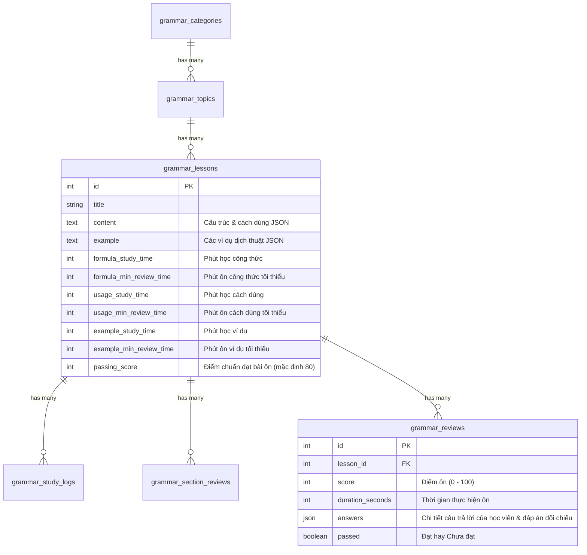

# 📖 Hướng Dẫn Hệ Thống Hóa, Quản Lý & Ôn Tập Ngữ Pháp (Grammar Module)

Tài liệu này chi tiết toàn bộ lộ trình, cấu trúc cơ sở dữ liệu, định tuyến và luồng xử lý chấm điểm ôn tập củng cố tự động của phân hệ Ngữ Pháp.

---

## 💾 1. Thiết Kế Cơ Sở Dữ Liệu (Database Schema)

Hệ thống ngữ pháp được thiết kế động (Database-driven) qua 6 bảng dữ liệu liên kết chặt chẽ:



### Chi tiết các bảng bổ sung cho tính năng Ôn tập & Cấu hình:
1. **`grammar_lessons` (Cập nhật cột cấu hình):** Cho phép đặt thời gian học lý thuyết ban đầu, thời gian ôn tập tối thiểu bắt buộc, và điểm số chuẩn đạt (ví dụ: `80`) cho từng phần nội dung: **Công thức (Formula)**, **Cách dùng (Usage)**, **Ví dụ (Examples)**.
2. **`grammar_reviews` (Lịch sử ôn tập):** Lưu vết từng lượt làm bài ôn tập củng cố của học viên. Cột `answers` lưu trữ cấu trúc so sánh đúng/sai của từng phần làm bài để tái hiện lại khi giáo viên hoặc học sinh nhấp vào xem chi tiết bài ôn.

---

## 🔌 2. Đăng Ký Định Tuyến (Web Routes)

Toàn bộ các URL tương tác của phân hệ được khai báo tại [routes/web.php](file:///d:/xampp/htdocs/quanlytienganh/routes/web.php):

| URL | HTTP Method | Tên Route | Chức Năng |
| :--- | :--- | :--- | :--- |
| `/grammar` | `GET` | `grammar.index` | Timeline Lộ trình học tổng quan dành cho Học viên |
| `/grammar/lesson/{id}` | `GET` | `grammar.lesson.show` | Chi tiết nội dung bài học lý thuyết |
| `/grammar/lesson/{id}/save-html` | `POST` | `grammar.lesson.save-html` | Lưu mã HTML giáo trình tương tác sau khi biên tập inline (Admin) |
| `/grammar/lessons/{id}/review` | `GET` | `grammar.lessons.review` | Trang làm bài ôn tập củng cố (Tái hiện công thức, cách dùng, dịch ví dụ) |
| `/grammar/lessons/{id}/review` | `POST` | `grammar.lessons.submit-review` | Nộp bài ôn, chạy bộ so khớp chuỗi Fuzzy Match, tính điểm & lưu logs |
| `/grammar/reviews/{id}` | `GET` | `grammar.reviews.show` | Xem chi tiết bài ôn (So sánh câu trả lời của học viên vs Đáp án chuẩn) |
| `/grammar-admin` | `GET` | `grammar.admin.index` | Bảng điều khiển quản trị, CRUD lộ trình & Báo cáo tiến trình học tập |

---

## ⚙️ 3. Luồng Xử Lý Chấm Điểm Ôn Tập (Active Recall Grading Flow)

Khi học viên nhấp vào **"Vào Ôn Tập & Củng Cố"** tại trang chi tiết bài học:

### Bước 1: Ghi nhận thời gian thực tế (Live Stopwatch)
* Tại màn hình ôn tập, một đồng hồ JavaScript đếm giây liên tục hoạt động.
* Khi nhấp nút nộp bài, tổng số giây tích lũy sẽ được gán vào trường ẩn `<input type="hidden" name="duration_seconds">` để gửi lên máy chủ.

### Bước 2: Chấm điểm tự động và So khớp chuỗi mờ (Fuzzy String Match)
Để tránh việc học sinh bị trừ điểm do sai sót dấu cách, viết hoa/thường hoặc dấu chấm cuối câu, hệ thống sử dụng thuật toán chuẩn hóa trước khi so sánh:
1. Chuyển toàn bộ chuỗi ký tự về chữ thường (`mb_strtolower`).
2. Loại bỏ tất cả ký tự đặc biệt, dấu câu (`.,?!;:+\-_/*()'"`).
3. Loại bỏ toàn bộ khoảng trắng dư thừa (`\s+`).

```php
// Thuật toán chuẩn hóa chuỗi của hệ thống
$normalize = function ($s) {
    $s = mb_strtolower($s, 'UTF-8');
    $s = preg_replace('/[.,?!;:+\-_\/*()\'"“”`~<>?@#$%^&|\\\]/', '', $s);
    $s = preg_replace('/\s+/', '', $s);
    return trim($s);
};
```

### Bước 3: Phân bổ trọng số điểm số (Tổng: 100 điểm)
* **Công thức (Formula) - Tối đa 30 điểm:** Gồm 3 thể: Khẳng định (+), Phủ định (-), Nghi vấn (?). Mỗi thể viết đúng được **10 điểm**.
* **Cách dùng (Usage) - Tối đa 30 điểm:** Điểm chia đều cho số lượng cách dùng được thiết lập trong bài học (`30 / Số cách dùng`). Nếu bất kỳ câu ghi nhớ nào khớp mờ với cách dùng trong DB, học viên nhận trọn điểm phần đó.
* **Ví dụ (Examples) - Tối đa 40 điểm:** Dịch câu Tiếng Anh dựa trên ngữ cảnh Tiếng Việt gợi ý. Điểm chia đều cho số ví dụ (`40 / Số ví dụ`).

### Bước 4: Tích hợp tự động vào Bảng báo cáo tiến độ chung (Admin Dashboard)
Sau khi tính tổng điểm và xác định trạng thái Đạt (Tổng điểm >= `passing_score`), hệ thống tự động:
1. **Lưu lịch sử bài ôn:** Tạo bản ghi mới trong `grammar_reviews` kèm JSON kết quả chi tiết từng câu.
2. **Cộng dồn thời gian & số buổi học:** Cập nhật bảng `grammar_study_logs` bằng cách quy đổi giây làm bài thành phút và cộng dồn vào cột `review_time`.
3. **Cập nhật trạng thái từng phần (Formula, Usage, Examples):** Cập nhật bảng `grammar_section_reviews` cho bài học đó:
   * Số lần ôn tập của từng phần được tăng lên 1 (`review_count++`).
   * Thời gian làm bài ôn được chia đều 1/3 cho mỗi phần và cộng dồn vào `review_time` của phần đó.
   * Điểm trung bình ôn tập của phần đó được tính lại dựa trên kết quả bài làm mới nhất.
   * Cập nhật trạng thái đạt chuẩn: **"Đạt"** khi và chỉ khi: `Điểm ôn >= passing_score` VÀ `Tổng thời gian đã ôn >= thời gian ôn tối thiểu` được giáo viên cấu hình.

---

## 🎨 4. Trải Nghiệm Giao Diện Premium (UI/UX) & Tính Năng Mới Bổ Sung

Hệ thống được thiết kế với chuẩn thẩm mỹ tối giản, tinh tế nhưng vô cùng premium và hiện đại:
* **Sidebar đồng bộ:** Sidebar học tập tự động kết nối các liên kết đến trang ôn tập và quản trị.
* **KPI sinh động:** Bảng tổng kết hiển thị giờ học tự quy đổi linh hoạt từ phút, tính tỉ lệ % tiến trình lộ trình và xếp hạng học lực học sinh tự động.
* **Collapsible Drawer (Admin):** Cho phép Admin chỉ cần nhấp vào bất kỳ dòng bài học nào, chi tiết 3 phần học sẽ trượt mở rộng mượt mà.
* **Lịch sử ôn tập chi tiết trọn vẹn (Multi-Attempt History Log) [MỚI]:** 
  * Thay vì chỉ lưu trữ/truy cập bài ôn gần nhất, hệ thống lưu trữ toàn bộ các lượt ôn tập của học viên dưới dạng lịch sử 1-N.
  * *Phía Học viên:* Tích hợp nút bấm **"📜 Lịch sử ôn tập (X lần)"** mở ra một **Bootstrap Modal Popup** cực kỳ mượt mà, hiển thị danh sách toàn bộ các lần làm bài ôn tập (Ngày giờ làm, Thời lượng làm bài, Điểm số, Trạng thái Đạt/Chưa đạt, cùng nút liên kết trực tiếp đến trang xem chi tiết bài làm).
  * *Phía Admin:* Ngay bên trong ngăn kéo trượt chi tiết của bài học, hiển thị danh sách bảng **"Lịch sử chi tiết tất cả các lần ôn tập của học viên"** xếp theo thứ tự mới nhất giúp giáo viên dễ dàng theo dõi mức độ tiến bộ qua từng lượt làm bài ôn tập.
* **Card Thống Kê Tiến Trình Học Tập Cá Nhân (Student Progress Stats Card) [MỚI]:**
  * Tích hợp một Card thống kê cực kỳ chi tiết ngay tại Sidebar trái của trang bài học học viên (`lesson-detail.blade.php`).
  * Hiển thị nhanh các chỉ số: Số buổi học, Số phút tích lũy học bài lý thuyết, Số phút tích lũy ôn tập.
  * Hiển thị trạng thái **Đạt / Chưa Đạt** bằng các badge bo tròn màu sắc riêng biệt cho từng phần nhỏ (Công thức, Cách dùng, Ví dụ) dựa theo cấu hình thời gian tối thiểu và điểm số chuẩn mà giáo viên thiết lập.
* **Giáo trình Tương tác & Bộ công cụ Highlighter (Interactive Textbook & Inline Editor) [MỚI]:**
  * Hỗ trợ lưu trữ giáo trình dưới dạng Rich HTML thô.
  * Chế độ Biên tập (`contenteditable="true"`) cho phép chỉnh sửa nội dung bài giảng trực quan.
  * Khi bôi đen văn bản hoặc click khối cũ, Floating Popover xuất hiện để chọn màu tô nổi (Đỏ, Xanh, Vàng, Lục) và gắn nhãn phân loại, tự động lưu trữ HTML sau khi chỉnh sửa.
  * Hỗ trợ chỉnh sửa thuộc tính hoặc gỡ bỏ hoàn toàn định dạng tô màu (unwrap) trực tiếp từ giao diện.
* **Mục lục kiến thức thông minh (Interactive Table of Contents) [MỚI]:**
  * Bổ sung sidebar bên trái hiển thị danh mục các kiến thức đã tô màu theo thời gian thực.
  * Click vào từng mục sẽ kích hoạt **Cuộn mượt mà (Smooth Scroll)** đưa khối văn bản tương ứng vào giữa màn hình và chạy hiệu ứng **Nhấp nháy làm nổi bật (Flash animation)**.

---

## 📚 5. Danh Mục Tài Liệu Chuyên Đề Ngữ Pháp

- **[Lời Gián Tiếp (Indirect Speech / Reported Speech)](file:///f:/htdocs/quanlytienganh/docs-quanlytienganh/docs/IndirectSpeech.md):** Tài liệu lý thuyết chuyên sâu, quy tắc lùi thì, đại từ, trạng từ, các cấu trúc câu trần thuật, câu hỏi, mệnh lệnh, động từ tường thuật đặc biệt và bài tập vận dụng có đáp án.

