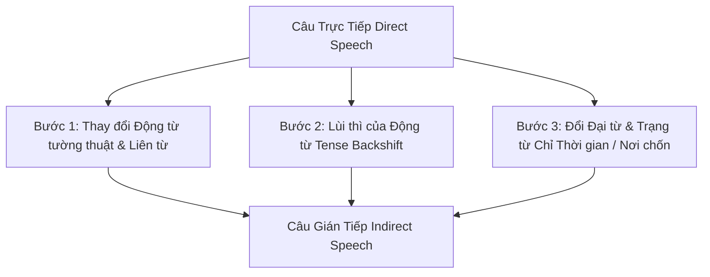

# 📖 Tài Liệu Ngữ Pháp Chuyên Đề: LỜI GIÁN TIẾP (INDIRECT SPEECH / REPORTED SPEECH)

Tài liệu hướng dẫn toàn diện về lý thuyết, cấu trúc, quy tắc biến đổi, các dạng câu tường thuật đặc biệt và bài tập ứng dụng cho cấu trúc **Lời Gián Tiếp (Indirect Speech / Reported Speech)**.

---

## 🎯 1. TỔNG QUAN VỀ LỜI GIÁN TIẾP (OVERVIEW)

### 1.1. Phân biệt Câu Trực Tiếp và Câu Gián Tiếp
* **Câu trực tiếp (Direct Speech):** Nhắc lại nguyên văn lời nói của người phát ngôn, được đặt trong dấu ngoặc kép `"..."`.
  * *Ví dụ:* Mary said, `"I am studying English now."`
* **Câu gián tiếp (Indirect / Reported Speech):** Thuật lại lời nói của người khác theo ngôn từ của người kể lại, không dùng dấu ngoặc kép và cần điều chỉnh thì, đại từ, trạng từ phù hợp.
  * *Ví dụ:* Mary said that **she was studying** English **then**.

---

## 🔑 2. QUY TẮC BÀN TAY VÀNG: 3 BƯỚC CHUYỂN ĐỔI BẮT BUỘC

Khi chuyển từ câu trực tiếp sang câu gián tiếp, học viên cần thực hiện **3 bước biến đổi**:

---

### BƯỚC 1: LÙI THÌ CỦA ĐỘNG TỪ (TENSE BACKSHIFTING)

> **Nguyên tắc chung:** Khi động từ tường thuật ở thì Quá khứ (`said`, `told`, `asked`...), toàn bộ các động từ trong mệnh đề được tường thuật phải **lùi một thì về quá khứ**.

#### Bảng Quy Tắc Lùi Thì Chi Tiết:

| Thì trong Câu Trực Tiếp (Direct) | Thì chuyển sang Câu Gián Tiếp (Indirect) | Ví dụ minh họa |
| :--- | :--- | :--- |
| **Present Simple** (Hiện tại đơn) | **Past Simple** (Quá khứ đơn) | `"I want tea."` → He said (that) he **wanted** tea. |
| **Present Continuous** (Hiện tại tiếp diễn) | **Past Continuous** (Quá khứ tiếp diễn) | `"I am reading."` → She said she **was reading**. |
| **Present Perfect** (Hiện tại hoàn thành) | **Past Perfect** (Quá khứ hoàn thành) | `"I have finished."` → He said he **had finished**. |
| **Present Perfect Cont.** (HTHT tiếp diễn) | **Past Perfect Cont.** (QKHT tiếp diễn) | `"I have been working."` → He said he **had been working**. |
| **Past Simple** (Quá khứ đơn) | **Past Perfect** (Quá khứ hoàn thành) | `"I bought a car."` → She said she **had bought** a car. |
| **Past Continuous** (Quá khứ tiếp diễn) | **Past Perfect Cont.** (QKHT tiếp diễn) | `"I was sleeping."` → He said he **had been sleeping**. |
| **Past Perfect** (Quá khứ hoàn thành) | **Past Perfect** *(Giữ nguyên)* | `"I had left early."` → She said she **had left** early. |
| **Future Simple** (`will + V`) | **Future in the Past** (`would + V`) | `"I will call you."` → He said he **would call** me. |
| **Modal Verbs:** | | |
| `can` | `could` | `"I can swim."` → He said he **could** swim. |
| `may` | `might` | `"It may rain."` → She said it **might** rain. |
| `must` / `have to` | `had to` | `"I must go."` → He said he **had to** go. |
| `shall` | `should` / `would` | `"What shall I do?"` → She asked what she **should** do. |
| `should` / `could` / `might` / `ought to` | *(Giữ nguyên)* | `"You should rest."` → He said I **should** rest. |

---

> [!WARNING]
> **CÁC TRƯỜNG HỢP KHÔNG LÙI THÌ (EXCEPTIONS):**
> 1. **Sự thật hiển nhiên, chân lý khách quan:**
>    * `"The sun rises in the East."` → The teacher said that the sun **rises** in the East. *(Không đổi thành rose)*
> 2. **Động từ tường thuật ở thì Hiện tại/Tương lai (`says`, `has said`, `will say`):**
>    * He says: `"I am tired."` → He says (that) he **is** tired.
> 3. **Câu điều kiện loại 2 và loại 3:**
>    * `"If I had money, I would buy it."` → He said that if he **had** money, he **would buy** it.
> 4. **Mệnh đề đi sau `wish`, `it's time`, `would rather`, `as if/as though`:**
>    * `"I wish I were rich."` → He said he wished he **were** rich.

---

### BƯỚC 2: THAY ĐỔI ĐẠI TỪ & TÍNH TỪ SỞ HỮU

Đại từ nhân xưng, đại từ sở hữu và tính từ sở hữu được thay đổi theo ngôi của người nói và người nghe:

| Ngôi trong lời nói trực tiếp | Quy tắc biến đổi |
| :--- | :--- |
| **Ngôi thứ nhất (`I`, `we`, `me`, `my`, `our`...)** | Đổi theo **Ngôi của Chủ ngữ (S)** trong câu tường thuật. |
| **Ngôi thứ hai (`you`, `your`, `yours`...)** | Đổi theo **Ngôi của Tân ngữ (O)** nhận lời nói trong câu tường thuật. |
| **Ngôi thứ ba (`he`, `she`, `it`, `they`...)** | **Giữ nguyên**, không thay đổi. |

---

### BƯỚC 3: THAY ĐỔI TRẠNG TỪ THỜI GIAN & NƠI CHỐN

| Trực tiếp (Direct) | Gián tiếp (Indirect) |
| :--- | :--- |
| `now` | `then` / `at that time` |
| `today` / `tonight` | `that day` / `that night` |
| `yesterday` | `the day before` / `the previous day` |
| `tomorrow` | `the next day` / `the following day` / `the day after` |
| `ago` | `before` |
| `this` | `that` |
| `these` | `those` |
| `here` | `there` |
| `last week / month / year` | `the previous week / month / year` |
| `next week / month / year` | `the following week / month / year` |

---

## 📐 3. CÁC DẠNG CÂU GIÁN TIẾP THƯỜNG GẶP

### 3.1. Dạng 1: Câu Trần Thuật (Statements)

#### Cấu trúc:
$$\text{S} + \text{said} + (\text{that}) + \text{S'} + \text{V (lùi thì)}$$
$$\text{S} + \text{told} + \text{O} + (\text{that}) + \text{S'} + \text{V (lùi thì)}$$

* *Ví dụ 1:* Direct: `"I live in Hanoi," John said.`
  * → Indirect: `John said (that) he lived in Hanoi.`
* *Ví dụ 2:* Direct: `"We will complete the project tomorrow," she said to me.`
  * → Indirect: `She told me (that) they would complete the project the following day.`

---

### 3.2. Dạng 2: Câu Hỏi (Questions)

#### A. Câu hỏi Yes/No (Yes/No Questions):
$$\text{S} + \text{asked} / \text{wanted to know} / \text{wondered} + (\text{O}) + \text{if} / \text{whether} + \text{S'} + \text{V (lùi thì)}$$

> **Lưu ý:** Chuyển câu hỏi về dạng trần thuật (Chủ ngữ đứng trước Động từ), **không dùng trợ động từ `do/does/did`** và bỏ dấu hỏi `?`.

* *Ví dụ:* Direct: `"Do you like English?" he asked me.`
  * → Indirect: `He asked me if / whether I liked English.`

#### B. Câu hỏi có từ để hỏi (Wh- Questions):
$$\text{S} + \text{asked} / \text{wanted to know} / \text{wondered} + (\text{O}) + \text{Wh-word} + \text{S'} + \text{V (lùi thì)}$$

* *Ví dụ 1:* Direct: `"Where are you going?" she asked Tom.`
  * → Indirect: `She asked Tom where he was going.`
* *Ví dụ 2:* Direct: `"Why didn't you attend the meeting?" the boss asked.`
  * → Indirect: `The boss asked why I had not attended the meeting.`

---

### 3.3. Dạng 3: Câu Mệnh Lệnh & Cầu Khiến (Commands & Requests)

#### Cấu trúc:
$$\text{Khẳng định: } \text{S} + \text{told} / \text{asked} / \text{ordered} / \text{advised} / \text{requested} + \text{O} + \text{to-V}$$
$$\text{Phủ định: } \text{S} + \text{told} / \text{asked} / \text{ordered} / \text{advised} / \text{requested} + \text{O} + \text{not to-V}$$

* *Ví dụ 1:* Direct: `"Open your book, please," the teacher said.`
  * → Indirect: `The teacher asked us to open our books.`
* *Ví dụ 2:* Direct: `"Don't make noise in class!" she said.`
  * → Indirect: `She told the students not to make noise in class.`

---

## 🌟 4. CÁC ĐỘNG TỪ TƯỜNG THUẬT ĐẶC BIỆT (SPECIAL REPORTING VERBS)

Trong các đề thi nâng cao (IELTS, THPT QG, TOEIC), câu gián tiếp thường sử dụng các động từ tường thuật chuyên biệt đi kèm với động từ nguyên mẫu (`to-V`) hoặc danh động từ (`V-ing`):

### 4.1. Động từ đi với `To-V` ($\text{S} + \text{V} + \text{to-V}$)
* `agree to-V`: Đồng ý làm gì
* `refuse to-V`: Từ chối làm gì
* `promise to-V`: Hứa làm gì
* `threaten to-V`: Đe dọa làm gì
* `offer to-V`: Đề nghị giúp làm gì

> *Ví dụ:* `"I will pay for the dinner," Jack said.`
> → `Jack promised / offered to pay for the dinner.`

---

### 4.2. Động từ đi với `O + To-V` ($\text{S} + \text{V} + \text{O} + \text{to-V}$)
* `advise O to-V`: Khuyên ai làm gì
* `encourage O to-V`: Khuyến khích ai làm gì
* `remind O to-V`: Nhắc nhở ai làm gì
* `warn O (not) to-V`: Cảnh báo ai (không) làm gì
* `invite O to-V`: Mời ai làm gì

> *Ví dụ:* `"You should take a rest, Mary," the doctor said.`
> → `The doctor advised Mary to take a rest.`

---

### 4.3. Động từ đi với `V-ing` ($\text{S} + \text{V} + \text{V-ing}$)
* `suggest V-ing`: Gợi ý làm gì
* `admit V-ing`: Thừa nhận làm gì
* `deny V-ing`: Phủ nhận làm gì

> *Ví dụ:* `"Let's go for a picnic this weekend," Peter said.`
> → `Peter suggested going for a picnic that weekend.`

---

### 4.4. Động từ đi với `Giới từ + V-ing` ($\text{S} + \text{V} + (\text{O}) + \text{Prep} + \text{V-ing}$)
* `apologize for V-ing`: Xin lỗi vì đã làm gì
* `accuse O of V-ing`: Buộc tội ai đã làm gì
* `congratulate O on V-ing`: Chúc mừng ai về việc gì
* `insist on V-ing`: Khăng khăng làm gì
* `thank O for V-ing`: Cảm ơn ai vì việc gì

> *Ví dụ 1:* `"I'm sorry I broke your vase," Tom said to Ann.`
> → `Tom apologized to Ann for breaking her vase.`
> *Ví dụ 2:* `"Congratulations! You won the prize," she said to me.`
> → `She congratulated me on winning the prize.`

---

## 📝 5. BÀI TẬP VẬN DỤNG & ĐÁP ÁN CHI TIẾT

### Bài 1: Chuyển các câu sau sang Câu Gián Tiếp (Reported Speech)

1. `"I am working on a new software project today," Mark said.`
2. `"Do you speak French fluent?" the interviewer asked Sarah.`
3. `"Why did you miss the deadline yesterday?" the manager asked Tom.`
4. `"Please don't turn off the air conditioner," she said to him.`
5. `"I will help you with your homework tomorrow," my brother promised.`
6. `"You stole my wallet!" the man said to the boy.`
7. `"Let's organize a charity event next week," Linda suggested.`

---

### Đáp án & Giải thích chi tiết Bài 1:

1. **Mark said (that) he was working on a new software project that day.**
   * *Giải thích:* Lùi `am working` → `was working`, đổi `I` → `he`, `today` → `that day`.
2. **The interviewer asked Sarah if / whether she spoke French fluently.**
   * *Giải thích:* Câu hỏi Yes/No, thêm `if/whether`, lùi `speak` → `spoke`, đổi `you` → `she`.
3. **The manager asked Tom why he had missed the deadline the day before.**
   * *Giải thích:* Câu hỏi Wh-, lùi Quá khứ đơn `did miss` → Quá khứ hoàn thành `had missed`, đổi `yesterday` → `the day before`.
4. **She asked / told him not to turn off the air conditioner.**
   * *Giải thích:* Câu mệnh lệnh phủ định: `told/asked + O + not to V`.
5. **My brother promised to help me with my homework the following day.**
   * *Giải thích:* Sử dụng cấu trúc đặc biệt `promise to V` + đổi `tomorrow` → `the following day`.
6. **The man accused the boy of stealing his wallet.**
   * *Giải thích:* Sử dụng cấu trúc đặc biệt buộc tội: `accuse + O + of + V-ing`.
7. **Linda suggested organizing / that they should organize a charity event the following week.**
   * *Giải thích:* Câu gợi ý: `suggest + V-ing` hoặc `suggest + that + S + (should) + V-bare`.
